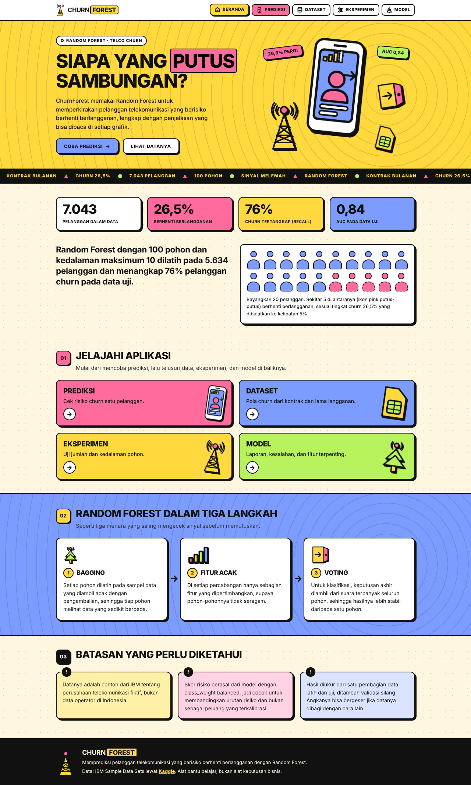
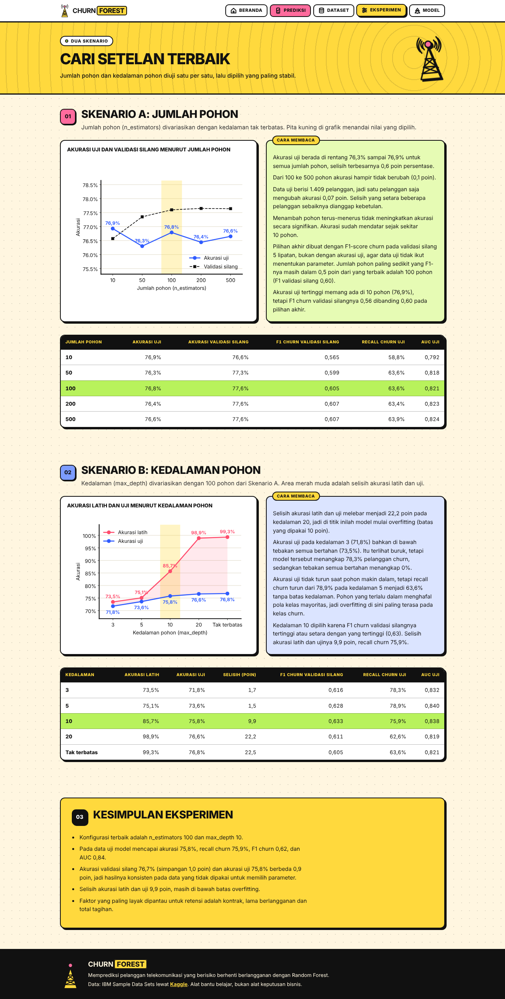

# ChurnForest - Prediksi Pelanggan Berhenti Berlangganan dengan Random Forest


Aplikasi web Flask untuk **klasifikasi** pelanggan telekomunikasi menjadi **churn** (berhenti berlangganan) atau **bertahan** menggunakan algoritma **Random Forest** (`RandomForestClassifier`). Setiap grafik disertai penjelasan yang dihitung ulang dari hasilnya, jadi teks ikut berubah kalau model dilatih ulang.

---

## Halaman Aplikasi

| Halaman | Isi |
|---|---|
| **Beranda** | Ringkasan hasil, jalan pintas ke halaman lain, cara kerja Random Forest, dan batasan model |
| **Prediksi** | Formulir pelanggan, skor risiko, suara 100 pohon, jalur keputusan satu pohon, saran retensi, dan profil dibanding data |
| **Dataset** | Ketidakseimbangan kelas, pola churn per kontrak dan lama berlangganan, preprocessing, daftar fitur |
| **Eksperimen** | Skenario A (jumlah pohon), Skenario B (kedalaman pohon), tabel hasil, dan kesimpulan |
| **Model** | Laporan klasifikasi, confusion matrix, kurva ROC, contoh satu pohon, dan 10 fitur paling berpengaruh |

Fitur lain: tampilan neo-brutalism yang responsif untuk ponsel, validasi input, kolom total tagihan yang boleh dikosongkan, dan dua contoh pelanggan untuk mencoba.

---

## Teknologi

| Komponen | Teknologi |
|---|---|
| Backend | Flask 3, Gunicorn |
| Machine Learning | scikit-learn (RandomForestClassifier, OneHotEncoder, ColumnTransformer, Pipeline) |
| Data Processing | Pandas, NumPy |
| Visualisasi | Matplotlib (keluaran SVG) |
| Penyimpanan Model | Joblib |
| Frontend | HTML (Jinja2), CSS, JavaScript |

---

## Dataset

- **Sumber:** [Kaggle - Telco Customer Churn](https://www.kaggle.com/datasets/blastchar/telco-customer-churn) (IBM Sample Data Sets, perusahaan telekomunikasi fiktif)
- **Jumlah data:** 7.043 baris (5.634 latih, 1.409 uji)
- **Fitur (19):** 16 kategorikal dan 3 numerik (tenure, MonthlyCharges, TotalCharges)
- **Target:** Churn (Yes = berhenti, No = bertahan)
- **Proporsi kelas:** 26,5% churn, 73,5% bertahan
- **Data hilang:** 11 baris TotalCharges berisi spasi kosong. Semuanya milik pelanggan dengan tenure 0, jadi diisi 0.
- **Preprocessing:** kolom customerID dibuang, SeniorCitizen diubah menjadi Yes atau No, kolom kategorikal di-one-hot encode, pembagian data 80:20 berstrata.
- **Imbalance:** ditangani dengan `class_weight="balanced"` pada semua model.

---

## Hasil Eksperimen

Pemilihan konfigurasi memakai **F1-score churn pada validasi silang 5 lipatan**, bukan akurasi uji. Alasannya, menebak semua pelanggan bertahan saja sudah benar 73,5%, jadi akurasi menyesatkan pada data ini. Konfigurasi yang dipilih adalah yang paling sederhana dengan F1 dalam 0,5 poin dari yang terbaik.

**Skenario A: jumlah pohon** (`max_depth=None`)

| n_estimators | Akurasi uji | Akurasi validasi silang | F1 churn validasi silang |
|---|---|---|---|
| 10 | 76,9% | 76,6% | 0,565 |
| 50 | 76,3% | 77,3% | 0,599 |
| **100** | 76,8% | 77,6% | 0,605 |
| 200 | 76,4% | 77,6% | 0,607 |
| 500 | 76,6% | 77,6% | 0,607 |

Akurasi uji hanya bergerak 0,6 poin untuk semua jumlah pohon, setara sekitar 9 pelanggan dari 1.409 data uji.

**Skenario B: kedalaman pohon** (`n_estimators=100`)

| max_depth | Akurasi latih | Akurasi uji | Selisih | Recall churn (uji) | AUC (uji) |
|---|---|---|---|---|---|
| 3 | 73,5% | 71,8% | 1,7 | 78,3% | 0,832 |
| 5 | 75,1% | 73,6% | 1,5 | 78,9% | 0,840 |
| **10** | 85,7% | 75,8% | 9,9 | 75,9% | 0,838 |
| 20 | 98,9% | 76,6% | 22,2 | 62,6% | 0,819 |
| Tak terbatas | 99,3% | 76,8% | 22,5 | 63,6% | 0,821 |

**Cara membaca hasil:**

- Overfitting mulai terlihat di kedalaman 20, saat selisih akurasi latih dan uji melewati batas 10 poin.
- Akurasi uji tidak turun saat pohon makin dalam, tetapi recall churn turun dari 78,9% menjadi 63,6%. Overfitting pada Random Forest di data ini muncul di kelas churn dan tidak terlihat dari akurasi saja.
- Akurasi uji kedalaman 3 (71,8%) di bawah tebakan semua bertahan (73,5%), tetapi model itu menangkap 78,3% pelanggan churn.

**Model akhir** (100 pohon, `max_depth=10`) pada 1.409 data uji:

| Metrik | Nilai |
|---|---|
| Akurasi | 75,8% |
| Akurasi validasi silang | 76,7% |
| Precision churn | 53% |
| Recall churn | 76% |
| F1 churn | 0,62 |
| AUC | 0,84 |

Confusion matrix: 784 benar bertahan, 251 salah ditandai churn, 90 churn terlewat, 284 churn tertangkap.

Tiga fitur teratas: lama berlangganan (12,8%), total tagihan (12,2%), dan kontrak bulanan (11,9%). Setelah kolom one-hot dijumlahkan per kolom asli, urutan teratasnya kontrak (18,9%), lama berlangganan, lalu total tagihan.

> **Catatan:** model ini alat bantu belajar, bukan alat keputusan bisnis. Datanya contoh dari IBM, dan skor risiko berasal dari model ber-class_weight balanced sehingga bukan peluang yang terkalibrasi.

---

## Instalasi Lokal

### 1. Clone repository

```bash
git clone https://github.com/Alnazh/ta06-telco-churn-random-forest.git
cd ta06-telco-churn-random-forest
```

### 2. Buat virtual environment

```bash
python -m venv venv

# Windows (PowerShell, jika muncul error execution policy:
# Set-ExecutionPolicy -Scope Process Bypass)
venv\Scripts\activate

# Linux / macOS
source venv/bin/activate
```

### 3. Install dependencies

```bash
pip install -r requirements.txt
```

### 4. Jalankan aplikasi

```bash
python app.py
```

Buka browser di `http://127.0.0.1:5000`. Model sudah tersedia di folder `model/`, jadi **tidak perlu melatih model lebih dulu**.

Jika versi scikit-learn di komputer kamu berbeda dari versi yang dipakai saat model disimpan, aplikasi otomatis melatih ulang model saat pertama dijalankan (sekitar satu menit). Setelah itu aplikasi langsung siap dipakai.

---

## Struktur Project

```
ta06-telco-churn-random-forest/
├── app.py              # Aplikasi Flask: rute, validasi, prediksi
├── config.py           # Jalur berkas, konstanta eksperimen, label, contoh isian
├── train_model.py      # Preprocessing, Skenario A dan B, model akhir, metrik
├── figures.py          # Grafik Matplotlib (SVG)
├── trees.py            # Jalur keputusan dan contoh pohon dari hutan
├── insights.py         # Teks penjelasan yang dihitung dari metrik
├── requirements.txt
├── Procfile            # Perintah Gunicorn
├── .gitignore
│
├── data/
│   └── WA_Fn-UseC_-Telco-Customer-Churn.csv
│
├── model/
│   ├── model.joblib    # Pipeline model akhir
│   └── metrics.json    # Semua metrik, hasil skenario, dan statistik data
│
├── templates/          # base, macros, index, dataset, experiments, model, predict, 404
├── static/
│   ├── style.css
│   ├── app.js
│   ├── favicon.svg
│   └── img/            # Grafik hasil pelatihan
│
└── docs/
    └── screenshots/    # Tangkapan layar aplikasi
```

---

## Training Ulang Model

```bash
python train_model.py
```

Script membersihkan data, membagi data 80:20, menjalankan Skenario A dan B, memilih konfigurasi, melatih model akhir, lalu menyimpan `model.joblib`, `metrics.json`, dan semua grafik. Teks penjelasan di aplikasi otomatis mengikuti hasil baru.

---

## Tampilan Aplikasi

### Beranda


### Eksperimen


---

## Cara Penggunaan

1. Buka halaman **Prediksi**.
2. Klik salah satu contoh pelanggan atau isi sendiri. Total tagihan boleh dikosongkan dan akan dihitung dari lama berlangganan dikali tagihan bulanan.
3. Klik **Periksa risiko**.
4. Aplikasi menampilkan skor risiko, penjelasan cara membacanya, saran retensi, dan tabel yang membandingkan profil pelanggan dengan tingkat churn di data.
